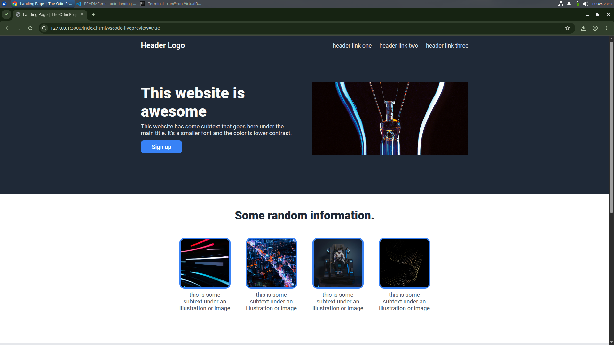

# Landing Page

A landing page built as part of [The Odin Project](https://www.theodinproject.com/) Foundations course.

## Preview



## Live Demo

[View Live Demo](https://rawnaq-code.github.io/odin-landing-page/)

## About the Project

The goal of this project was to recreate a landing page design provided by The Odin Project using HTML and CSS.

The page includes a navigation bar, hero section, information cards, a quote section, a call-to-action section, and a footer.

## Built With

- HTML5
- CSS3
- Flexbox
- Roboto font

## What I Learned

- Structuring a webpage with HTML.
- Using Flexbox to arrange and align elements.
- Styling elements with CSS.
- Working with colors, typography, spacing, margins, and padding.
- Using images in a webpage.
- Organizing and publishing a project using Git and GitHub.

## Getting Started

To run the project locally:

1. Clone the repository:

   ```bash
   git clone YOUR_REPOSITORY_URL
   ```

2. Open the project folder.

3. Open `index.html` in your browser.

## Acknowledgments

- [The Odin Project – Foundations Landing Page](https://www.theodinproject.com/lessons/foundations-landing-page)